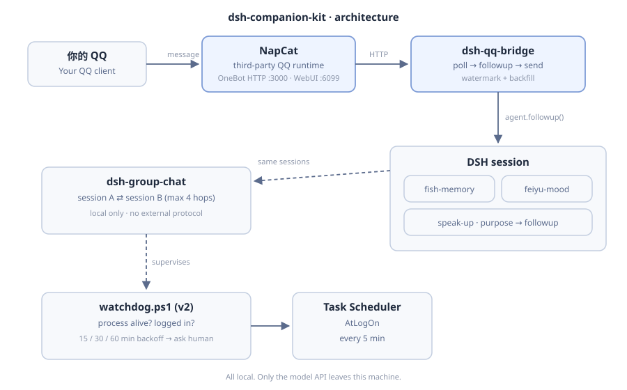

# dsh-companion-kit

> A **deployment kit** for putting an AI companion into QQ: NapCat launcher + watchdog, a multi-session local group-chat plugin, a few patches, and the notes on what actually breaks.
>
> This is not "yet another QQ bot framework". It contains none of the upstream plugin code — it wires them together and keeps you from babysitting a dead login at 2 a.m.

**Tested on**: Windows 11 (build 26200) + DSH `0.2.1-rc.5` + NapCat Shell `9.9.31`.
The launcher, watchdog and scheduled tasks all ran on that combination — the traps in these docs were collected the hard way there.

⚠️ **Read this first**
- NapCat is a third-party QQ runtime, not affiliated with Tencent. **Automating a QQ account carries a real ban risk.** Use a throwaway account.
- This repo contains no real account IDs, passwords, cookies, or chat logs.
- Character personas based on third-party works are fan content and **must not be used commercially**.
- No warranty of any kind. Ban, data loss, account restriction — your responsibility.

---

## Where this came from

Let's be honest: **this is not the work of a programmer.**

The author is a medical student who built all of this by working with an AI, step by step.
Every trap listed here — "the execution policy silently blocked the script", "one missing backslash
in the config made it fall back to defaults without a word", "without admin you cannot register
a logon task" — was hit **first**, debugged, and only then written down.

So the commands in these docs **have been run for real**. But:

> **Your machine is not my machine. Follow the docs and you will hit something I never saw.**

That is not a disclaimer to hide behind; it is simply how this kind of setup works.
Windows version, NapCat version, DSH version, admin rights, whether your path contains spaces —
change any one of them and behaviour can differ.

### How to use this

1. Change **one thing at a time** and verify immediately — don't configure everything then hope
2. When something breaks, **read the logs first** (`napcat-out.log`, `napcat-watchdog.log`)
3. Search the exact error text before editing any script
4. Once it works, send your differences back — that is how the next person's experience improves

This is a **route map**, not a babysitter. It assumes you are willing to try, read logs, and iterate.

---

## What it solves

Wiring a DSH session to your QQ usually means assembling four or five moving parts, and then running into these:

| Symptom | What this repo gives you |
|---|---|
| NapCat is running but logged out — endless QR loop | `watchdog.ps1` — detects "process alive, session dead", restarts with backoff |
| Manual launch every boot | `register-tasks.ps1` — at-logon + 5-minute check |
| Black console flashes on start | `run-hidden.vbs` — wscript wrapper, no window |
| Want several characters talking in one group | `plugins/group-chat` — original plugin |
| Plugin changes wiped by an update | `patches/` — e.g. speak-up "purpose" patch |

---

## Architecture



```
Your QQ
   │
   ▼
NapCat (third-party, install yourself)   OneBot HTTP :3000 / WebUI :6099
   │  polling
   ▼
dsh-qq-bridge (upstream plugin)          receive / send
   │  agent.followup()
   ▼
DSH session
   ├─ dsh-fish-memory   long-term memory (fades)
   ├─ dsh-feiyu-mood    mood
   └─ dsh-speak-up      starts conversations on its own
```

Details in [docs/架构.md](docs/架构.md) (Chinese).

---

## What's inside / what's not

**Inside**

```
docs/            architecture, deployment, troubleshooting, risk & compliance
scripts/napcat/  launcher, watchdog v2, hidden-window wrapper, config loader
scripts/register-tasks.ps1   register both scheduled tasks
plugins/group-chat/          original: multi-session local group chat
patches/                     changes to upstream plugins
config/                      sanitized config template
```

**Not inside** (install yourself; all MIT upstream)

- `dsh-qq-bridge`, `dsh-speak-up`, `dsh-feiyu-mood`, `dsh-fish-memory` — upstream plugins
- NapCat / QQ NT runtime — third party, get it from its official releases
- Any account, password, or token

---

## Quick start

```powershell
# 1. Install NapCat somewhere (e.g. D:\NapCat) and confirm you can log in

# 2. Configure
cd scripts\napcat
copy napcat.conf.example.json napcat.conf.json
notepad napcat.conf.json      # set NapCatDir / QQAccount

# 3. Register scheduled tasks
cd ..\..
powershell -ExecutionPolicy Bypass -File scripts\register-tasks.ps1
```

After that: log in to Windows → NapCat starts hidden; every 5 minutes the watchdog checks;
a dead session is restarted (max 3 attempts, then it stops and writes "manual QR scan required"
to `napcat-watchdog.log`).

Full steps: [docs/部署.md](docs/部署.md) (Chinese).

---

## group-chat plugin

Pulls several DSH sessions into one local group: whoever finishes a turn has their last message
relayed to the other members, tagged with the speaker and a hop counter.

```
member A speaks → relayed to B → B replies → relayed back → … stops at 4 hops
```

Three loop guards: max 4 hops per burst / 10 minutes of silence starts a new burst /
8 relays per session per hour. See [plugins/group-chat/README.md](plugins/group-chat/README.md).

---

## License

Original parts: MIT (see [LICENSE](LICENSE)).
Upstream plugins keep their own licenses (all MIT); copyright belongs to their authors.
Docs: CC BY 4.0 — attribution appreciated.
